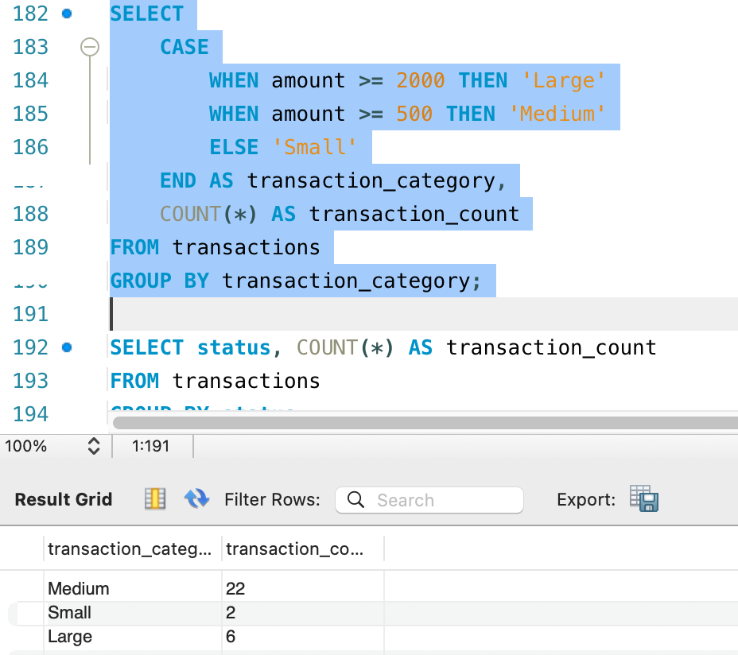
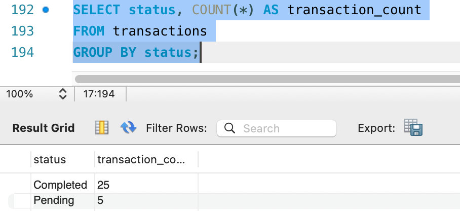

# SQL Financial Data Analysis 

**Status:** 🟢 completed

## Goal
This project uses SQL to analyse financial transaction data and answer practical business questions. The aim is to develop my SQL skills and demonstrate how data can support financial reporting and decision-making.

## Skills demonstrated (as the project progresses)
- Writing SQL queries: SELECT, WHERE, ORDER BY
- Aggregation with GROUP BY, SUM, COUNT and AVG
- Joining tables
- Cleaning and checking data
- Summarising findings clearly for a non-technical reader

## Planned deliverables
- [X] Choose and document the dataset (source and description)
- [X] Set up the database and load the data
- [X] Write queries answering 5 to 10 business questions
- [X] Save all queries in a `queries/` folder with comments
- [X] Write a short summary of findings
- [ ] Maintain a project progress log

## Tools
- MySQL 8
- MYSQL Workbeanch
- GitHub

## Repository Structure

```text
sql-financial-data-analysis/
├── README.md
└── sql/
    └── transactions_analysis.sql
```
## Progress log
- Oct 2026: Repository created and project planned.
- Current Focus : Practising SQL fundamentals, Including filtering, sorting, aggregation and grouping
- Oct 2026: Documented the dataset, added findings, project completed.

## Sample Results

## Dataset
- - **Source:** Sample data for SQL practice. The transactions table was created by me; the companies table was generated with AI assistance. Neither contains real company data.
- **Database:** finance_practice
- **Tables:** transactions (30 rows), companies (7 rows)

### transactions columns
| Column | Type | Description |
|---|---|---|
| transaction_id | int (primary key) | Unique ID for each transaction |
| department | varchar(30) | Department the transaction belongs to |
| transaction_type | varchar(20) | Type of transaction, e.g. Expense or Revenue |
| amount | decimal(10,2) | Transaction value |
| transaction_date | date | Date the transaction happened |
| payment_method | varchar(20) | How the transaction was paid |
| status | varchar(20) | Transaction status, e.g. Pending |

### companies columns
| Column | Type | Description |
|---|---|---|
| company_id | int (primary key, auto-increment) | Unique ID for each company |
| company_name | varchar(100) | Name of the company |
| ticker_symbol | varchar(10) | Stock ticker symbol of the company |
| sector | varchar(50) | Sector the company operates in |
| country | varchar(50) | Country the company is based in |

### Total amount by department


### Transaction report by department and type


### Transactions by category


### Transactions by status


## Findings
- Sales is the largest department by total transaction amount at 20,400, just over half of the 40,750 total across all 30 transactions.
- IT has the highest expenses at 7,100, followed by Marketing (5,450), Finance (5,400) and HR (2,400).
- Sales has no Expense transactions, so the expense analysis covers the other four departments only.
- Four of the five departments have a total above 5,000. HR is the only one below, at 2,400.
- Most transactions are mid-sized: 22 of 30 (73%) are Medium (500 to 1,999), 6 (20%) are Large (2,000 or more) and only 2 (7%) are Small (under 500).
- 25 of the 30 transactions are Completed and 5 (about 17%) are still Pending.
