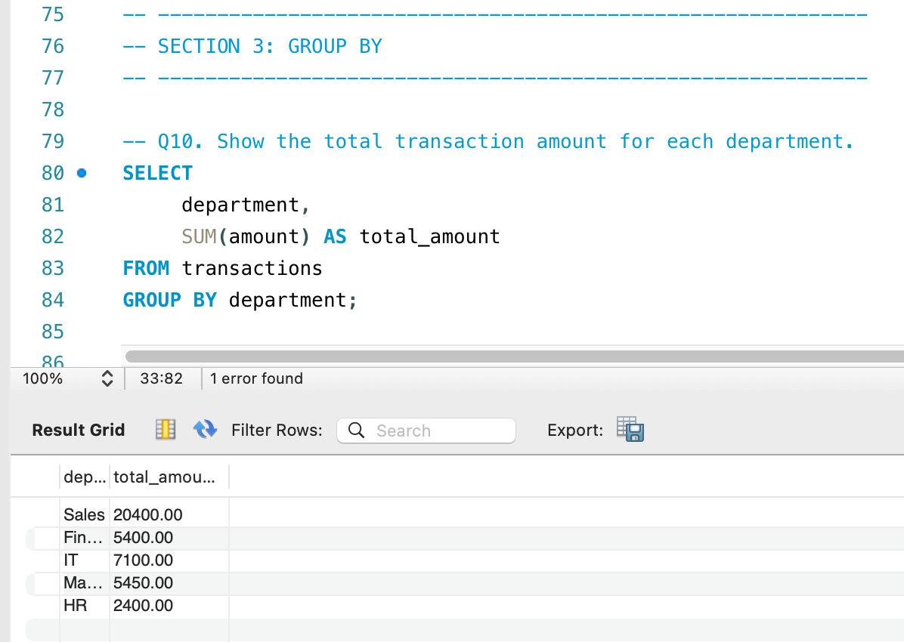
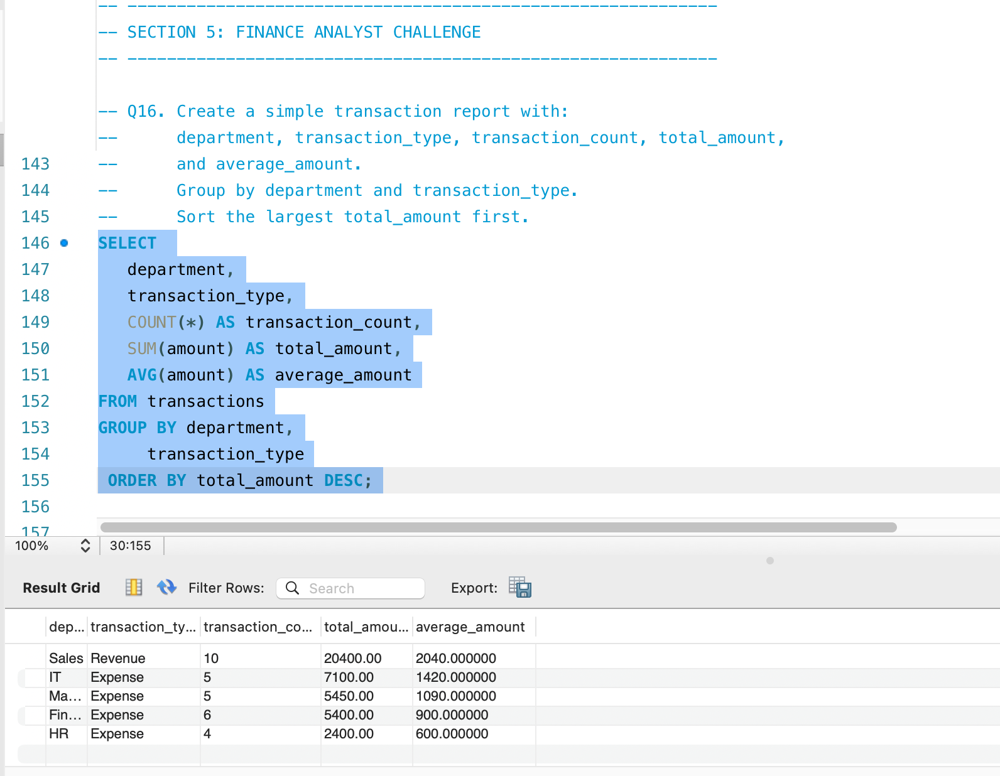

# SQL Financial Data Analysis

**Status:** 🟡 In Progress

## Goal
This project uses SQL to analyse financial transaction data and answer practical business questions. The aim is to develop my SQL skills and demonstrate how data can support financial reporting and decision-making.

## Skills demonstrated (as the project progresses)
- Writing SQL queries: SELECT, WHERE, ORDER BY
- Aggregation with GROUP BY, SUM, COUNT and AVG
- Joining tables
- Cleaning and checking data
- Summarising findings clearly for a non-technical reader

## Planned deliverables
- [X] Choose and document the dataset (source and description)
- [ ] Set up the database and load the data
- [X] Write queries answering 5 to 10 business questions
- [X] Save all queries in a `queries/` folder with comments
- [ ] Write a short summary of findings
- [ ] Maintain a project progress log

## Tools
- MySQL 8
- MYSQL Workbeanch
- GitHub

## Repository Structure

```text
sql-financial-data-analysis/
├── README.md
└── sql/
    └── transactions_analysis.sql
```
## Progress log
- Oct 2026: Repository created and project planned.
- Current Focus : Practising SQL fundamentals, Including filtering, sorting, aggregation and grouping

## Sample Results

## Dataset
- **Source:** [Sample data I created for practice / name of public source and link]
- **Database:** finance_practice
- **Tables:** transactions ([number] rows), companies ([number] rows)

### transactions columns
| Column | Description |
|---|---|
| transaction_id | Unique ID for each transaction |
| transaction_date | Date the transaction happened |
| amount | Transaction value |
| transaction_type | Expense or Revenue |
| department | Department the transaction belongs to |
| status | Transaction status, e.g. Pending |

### companies columns
| Column | Description |
|---|---|
| company_name | Name of the company |
| sector | Sector the company operates in |

### Total amount by department


### Transaction report by department and type

